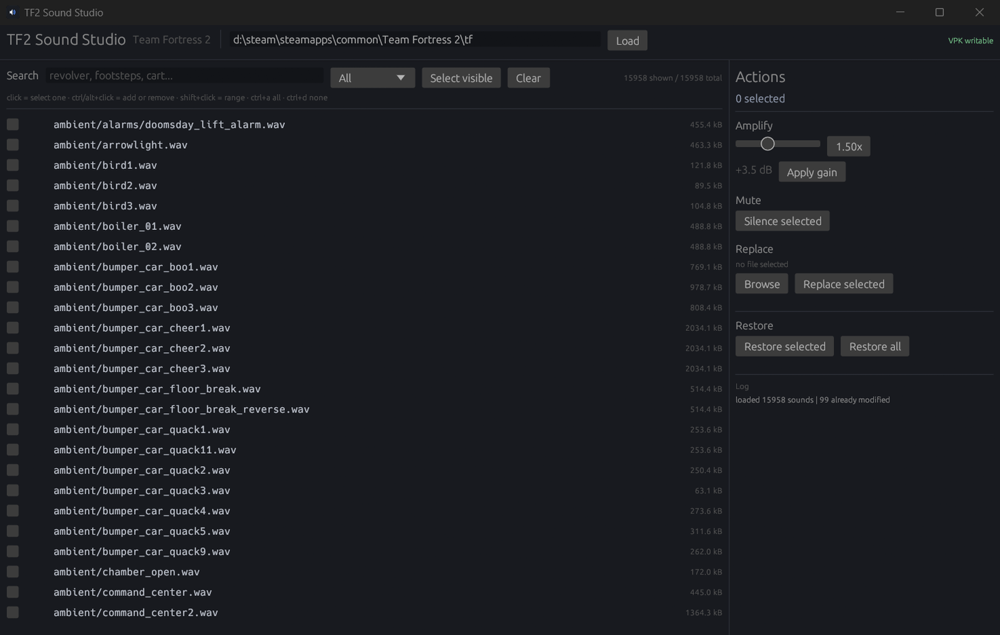

# TF2 Sound Studio

A small desktop tool for editing Team Fortress 2 sound waves: **mute**, **amplify** and **replace**
any of the ~16,000 `.wav`/`.mp3` entries in `tf2_sound_misc` and `tf2_sound_vo_english`.

Written in Rust with [egui](https://github.com/emilk/egui). Single self-contained executable.



## Why edit the VPK instead of a custom folder

`sv_pure` servers ignore `tf/custom` soundscripts and loose `.wav` overrides, and the server's own
precache table fixes the wave path per sound (visible in `console.log` as `)items/cart_rolling.wav`).
The only thing that survives is the byte content behind that exact path. This tool rewrites the
VPK entry **in place, keeping the original length**, so the archive tree stays valid and the file
is served as-is.

## Features

- Lists every sound in both sound packs (15,958 entries) with instant search
- Explorer-style selection: any click anywhere on a row selects it (and clicking the
  same row again deselects), Ctrl/Alt+click toggles, Shift+click selects the range from
  the last anchor even after scrolling, Ctrl+A selects everything visible, Ctrl+D clears
- Amplify 0.1x - 4.0x with live dB readout; samples are clamped, so the wave keeps
  its exact byte length
- Mute (zeroes the PCM payload, header preserved)
- Replace with any `.wav`: the file is validated on pick (16-bit PCM only, format and
  duration shown), then resampled to the target rate, channel-converted and fitted to
  the original slot
- Restore selected / restore all from a backup that lives next to the game
- Filters: All / Modified / Original, modified rows marked `M`
- Refuses to write while `tf_win64.exe` is running (the VPKs are locked)
- No console window, speaker icon embedded in the exe and the window

## Build

Requires Rust (stable) and the MSVC toolchain on Windows.

```
cargo build --release
# -> target/release/tf2-sound-studio.exe
```

`build.rs` embeds `icon.ico` into the executable (`winres`); if the resource compiler is missing the
build still succeeds with a warning.

## Usage

1. Close Team Fortress 2.
2. Run `tf2 sound studio.exe`. The game folder is auto-detected from the Steam registry and
   `libraryfolders.vdf`; paste a path and press `Load` if detection fails.
3. Search, select rows, then amplify / mute / replace / restore.
   - Amplify: set the slider, press `Apply gain`.
   - Mute: `Silence selected`.
   - Replace: hit `Browse`, pick a 16-bit PCM `.wav`, check the format line
     (`Hz | channels | bit | seconds`), then `Replace selected`. The source is resampled
     and padded/trimmed to fit the target slot exactly, so the VPK entry stays the same size.
   - Undo: `Restore selected`, or `Restore all` for every file the tool has touched.
4. Backups are written to `<tf>\sound_studio_backup.bin`. Editing is reversible until you delete it.
   Original waves produced by the earlier Python helpers (`cart_silence_backup.bin`,
   `footstep_gain_backup.bin`) are imported automatically on first launch, so those files are
   restorable too.

`--verify` prints pack entry counts and wav metadata without touching anything.


## Safety behaviour

- Backups are written to disk **before** the game file is modified, so an interrupted run
  never leaves an un-backed-up wave.
- All edits start from the stored original, so pressing `Apply gain` twice does not stack
  (1.5x twice is still 1.5x, not 2.25x).
- Changing the search text or filter clears the selection, so hidden rows cannot be edited.
- Only 8-bit and 16-bit PCM waves are supported. MP3/float/24-32-bit entries are reported as
  skipped and are **not** marked modified.
- Muting 8-bit PCM writes 0x80 (the unsigned midpoint), not 0x00, so it is silence instead of
  a click.
- Replacement audio keeps its own channels: stereo stays stereo, mono is duplicated, stereo into
  mono is mixed down.
- Every write is read back and compared; a failed write is counted as a failure, not "ok".
- Corrupt VPK directories, damaged backup files and unreadable replacement WAVs are reported in
  the log instead of crashing.

## Issues and feature requests

Bug reports and ideas are welcome: <https://github.com/Repurify/tf2-sound-studio/issues>

When opening a bug report, include:

- the sound path (for example `sound/items/cart_rolling.wav`), or the search term you used
- what you pressed (amplify / silence / replace / restore) and the slider value
- the last line from the log panel in the Actions column
- for a crash: the exact message and whether TF2 was running at the time
- whether Steam *verify integrity* was run since the last edit

Feature requests: describe the workflow you want, not only the button. That makes it much
easier to tell whether it belongs in the tool or is better handled with a soundscript.

## Limitations

- Steam *verify integrity* or a game update restores original waves; re-apply afterwards.
- Sound range is server-authoritative. Changing sample amplitude or the soundscript's
  `soundlevel` does not extend how far a sound is networked to you; distant sounds are culled
  server-side.
- Client-side only. Nothing here changes hit registration, damage or movement.

## License

MIT
